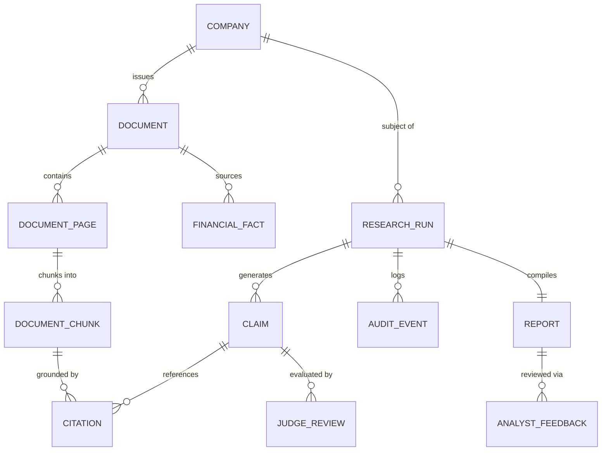

# Data Model Specification

## 1. Relational Entities (SQLite Authoritative Store)

The authoritative SQLite database tracks persistent entities, financial facts, research execution runs, and audit trails.

---

## 2. Table Schemas & Relationships

### `companies`
- `id` (INTEGER, Primary Key)
- `ticker` (VARCHAR, Unique, Indexed) — e.g., `"AAPL"`, `"MSFT"`
- `cik` (VARCHAR, Indexed) — SEC Central Index Key
- `company_name` (VARCHAR, Not Null)
- `jurisdiction` (VARCHAR) — `"US"`, `"IN"`, etc.
- `industry` (VARCHAR)
- `created_at` (TIMESTAMP)

### `documents`
- `id` (VARCHAR, Primary Key) — `doc_...`
- `company_id` (INTEGER, Foreign Key to `companies.id`)
- `filename` (VARCHAR, Not Null)
- `file_path` (VARCHAR, Not Null)
- `file_size_bytes` (INTEGER)
- `sha256_hash` (VARCHAR, Unique, Indexed) — Content fingerprint
- `source_type` (VARCHAR) — `"SEC_EDGAR"`, `"MANUAL_UPLOAD"`, `"STATUTORY_FILING"`
- `filing_type` (VARCHAR) — `"10-K"`, `"10-Q"`, `"8-K"`, `"ANNUAL_REPORT"`
- `fiscal_year` (INTEGER)
- `fiscal_period` (VARCHAR) — `"FY"`, `"Q1"`, `"Q2"`, `"Q3"`, `"Q4"`
- `ingestion_status` (VARCHAR) — `"REGISTERED"`, `"PARSED"`, `"INDEXED"`, `"FAILED"`
- `extraction_warnings` (TEXT)
- `created_at` (TIMESTAMP)

### `document_pages`
- `id` (INTEGER, Primary Key)
- `document_id` (VARCHAR, Foreign Key to `documents.id`)
- `page_number` (INTEGER, Not Null)
- `raw_text` (TEXT)
- `has_tables` (BOOLEAN)
- `layout_metadata` (JSON)

### `document_chunks`
- `id` (VARCHAR, Primary Key) — `chk_...`
- `document_id` (VARCHAR, Foreign Key to `documents.id`)
- `page_number` (INTEGER)
- `chunk_index` (INTEGER)
- `chunk_type` (VARCHAR) — `"TEXT"`, `"TABLE_ROW"`, `"FOOTNOTE"`
- `content` (TEXT, Not Null)
- `token_count` (INTEGER)
- `qdrant_point_id` (VARCHAR) — Pointer to vector index

### `financial_facts`
- `id` (INTEGER, Primary Key)
- `company_id` (INTEGER, Foreign Key to `companies.id`)
- `document_id` (VARCHAR, Foreign Key to `documents.id`)
- `metric_name` (VARCHAR, Indexed) — e.g., `"TotalRevenue"`, `"NetIncome"`, `"OperatingCashFlow"`
- `standardized_metric` (VARCHAR, Indexed) — Canonical taxonomy term
- `raw_value` (VARCHAR) — Text as reported, e.g. `"$211,915"`
- `decimal_value` (NUMERIC(20, 4)) — Normalized numeric value: `211915000000.00`
- `unit` (VARCHAR) — `"USD"`, `"INR"`, etc.
- `scale` (VARCHAR) — `"THOUSANDS"`, `"MILLIONS"`, `"BILLIONS"`
- `fiscal_year` (INTEGER)
- `fiscal_period` (VARCHAR) — `"FY"`, `"Q1"`, `"Q2"`, etc.
- `source_table_name` (VARCHAR) — e.g., `"CONSOLIDATED STATEMENTS OF INCOME"`
- `page_number` (INTEGER)
- `is_restated` (BOOLEAN, Default False)

### `research_runs`
- `id` (VARCHAR, Primary Key) — `run_...`
- `company_id` (INTEGER, Foreign Key to `companies.id`)
- `status` (VARCHAR, Indexed) — `"QUEUED"`, `"INGESTING"`, `"ANALYZING"`, `"VERIFYING"`, `"AWAITING_HUMAN_REVIEW"`, `"COMPLETED"`, `"FAILED"`
- `current_stage` (VARCHAR)
- `progress_percent` (INTEGER)
- `error_message` (TEXT)
- `created_at` (TIMESTAMP)
- `completed_at` (TIMESTAMP)

### `claims`
- `id` (VARCHAR, Primary Key) — `clm_...`
- `run_id` (VARCHAR, Foreign Key to `research_runs.id`)
- `analyst_role` (VARCHAR) — e.g., `"profitability"`, `"cash_flow"`
- `statement` (TEXT, Not Null)
- `claim_type` (VARCHAR) — `"NUMERICAL_FACT"`, `"TREND_ANALYSIS"`, `"RISK_FACTOR"`, `"CALCULATION"`
- `status` (VARCHAR) — `"PASS"`, `"QUALIFY"`, `"RETRIEVE_MORE"`, `"BLOCK"`, `"INDETERMINATE"`
- `confidence_score` (FLOAT)
- `created_at` (TIMESTAMP)

### `citations`
- `id` (INTEGER, Primary Key)
- `claim_id` (VARCHAR, Foreign Key to `claims.id`)
- `document_chunk_id` (VARCHAR, Foreign Key to `document_chunks.id`)
- `page_number` (INTEGER)
- `exact_quote` (TEXT)
- `relevance_score` (FLOAT)

### `judge_reviews`
- `id` (INTEGER, Primary Key)
- `claim_id` (VARCHAR, Foreign Key to `claims.id`)
- `judge_role` (VARCHAR) — `"evidence_auditor"`, `"financial_integrity"`, `"adversarial_skeptic"`
- `verdict` (VARCHAR) — `"PASS"`, `"QUALIFY"`, `"BLOCK"`, `"RETRIEVE_MORE"`, `"INDETERMINATE"`
- `rationale` (TEXT)
- `detected_contradiction` (TEXT)
- `created_at` (TIMESTAMP)

### `reports`
- `id` (VARCHAR, Primary Key) — `rep_...`
- `run_id` (VARCHAR, Foreign Key to `research_runs.id`, Unique)
- `title` (VARCHAR)
- `executive_summary` (TEXT)
- `structured_content` (JSON) — Detailed sections, metrics, and tables
- `markdown_output` (TEXT)
- `published_at` (TIMESTAMP)

### `analyst_feedback`
- `id` (INTEGER, Primary Key)
- `report_id` (VARCHAR, Foreign Key to `reports.id`)
- `reviewer_name` (VARCHAR)
- `overall_decision` (VARCHAR) — `"APPROVED"`, `"REJECTED"`, `"MODIFIED"`
- `comments` (TEXT)
- `claim_overrides` (JSON)
- `created_at` (TIMESTAMP)

### `audit_events`
- `id` (INTEGER, Primary Key)
- `run_id` (VARCHAR, Foreign Key to `research_runs.id`)
- `timestamp` (TIMESTAMP)
- `stage` (VARCHAR)
- `component` (VARCHAR)
- `event_type` (VARCHAR) — `"INFO"`, `"WARNING"`, `"ERROR"`, `"GATE_TRIGGER"`
- `details` (JSON)
