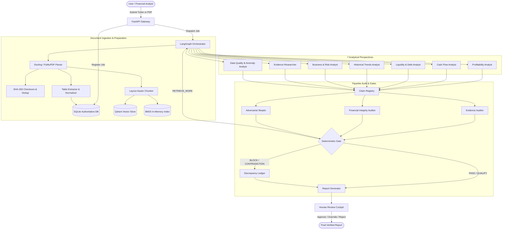

# System Architecture Specification

## 1. High-Level Architecture Flow

This document details the components, data boundaries, and operational lifecycles of the **Trustworthy Multi-Agent Financial Research and Decision Support System**.

---

## 2. Component Boundaries & Responsibilities

| Component | Technology | Primary Responsibility | Truth Guarantee |
| :--- | :--- | :--- | :--- |
| **Frontend UI** | HTML5, CSS3, Vanilla ES JS | Human review, evidence inspection, workflow monitoring | Displays claims with direct citation pills |
| **API Layer** | FastAPI, Pydantic | REST endpoints, input sanitization, background execution | Strictly typed request/response schemas |
| **State Machine** | LangGraph | Coordinates analysis steps, bounded retries, gates | Explicit transitions, no infinite loops |
| **Document Ingestion** | Docling, PyMuPDF | Layout preservation, table extraction, chunking | SHA-256 fingerprinting of all inputs |
| **Authoritative Store** | SQLite / SQLAlchemy | Entities, financial facts, job state, claims, feedback | ACID transactions, primary source of facts |
| **Vector Index** | Qdrant Local | Semantic text search across filings & footnotes | Auxiliary retrieval; not primary fact truth |
| **Lexical Index** | Rank-BM25 | Keyword & ticker matching | Prevents dense semantic drift on rare terms |
| **Reranker** | Cross-Encoder MiniLM | Second-stage passage relevance scoring | Top-K precision refinement |
| **Calculations** | Python `Decimal` / Pandas | Financial ratios, growth rates, margins | 100% deterministic arithmetic |
| **Review & Audit** | 3 Verification Judges | Source alignment, formula checking, contradiction check | Emits explicit gate verdicts |

---

## 3. Storage Architecture: SQLite vs. Qdrant

A key architectural requirement is the strict division of responsibility:
1. **SQLite (`data/financial_research.db`)**:
   - Contains normalized tables: `companies`, `documents`, `pages`, `financial_facts`, `runs`, `claims`, `citations`, `judge_reviews`, `audit_events`.
   - All balance sheet, income statement, and cash flow numbers are stored as structured decimal values with fiscal year, quarter, currency, and unit attributes.
2. **Qdrant (`data/qdrant/`)**:
   - Stores dense vectors of narrative text chunks and MD&A sections.
   - Used to locate qualitative context, management commentary, risk factors, and accounting footnotes.
   - Vector hits are always verified against SQLite facts before final report inclusion.

---

## 4. Failure Modes & Bounded Execution

- **Timeout & Retries**: External API requests (SEC EDGAR) are bounded by timeouts and exponential backoff (max 3 retries).
- **Missing Data Handling**: If a financial metric is absent (e.g., R&D expense for a holding company), the system records an explicit `INDETERMINATE` status with an explanation rather than hallucinating 0 or average estimates.
- **Circuit Breaker on Retrieval**: Retrieval loops (`RETRIEVE_MORE`) are hard-bounded to a maximum of 2 iterations to avoid execution runaway.
